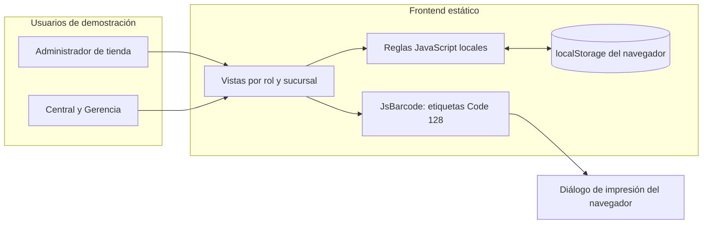
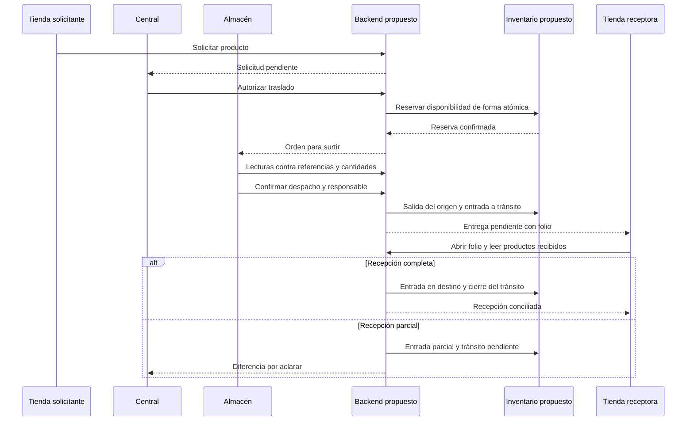
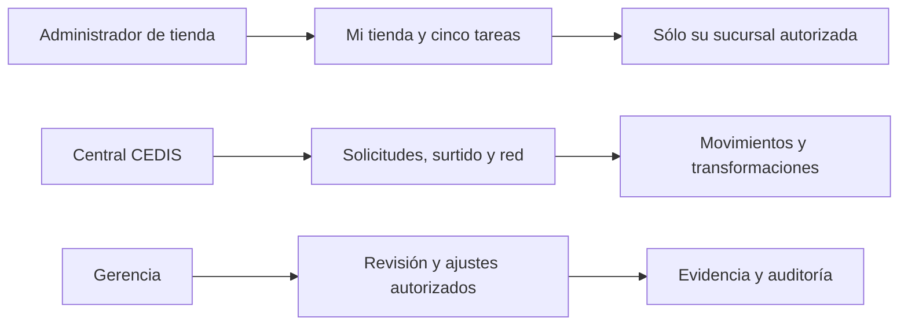
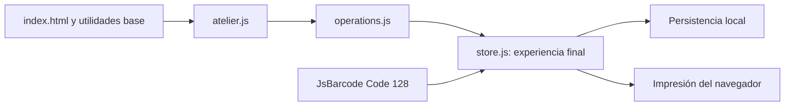

# Pinturas JM · operación comercial y atelier de color

Prototipo interactivo de **SyborX** para explorar la operación de **Pinturas JM S.A. de C.V.: 11 sucursales y un centro de distribución (CEDIS/PJM)**. Este repositorio entrega el frontend demostrativo y un manual de interpretación, operación y desarrollo para quienes construirán el sistema definitivo.

**Estado:** prototipo funcional en navegador, con datos ficticios y persistencia local. **No es un ERP productivo, un backend ni una integración ya realizada con SAE, IA o maquinaria.**

- [Prototipo privado publicado](https://pinturas-jm-operacion.karlozvx.chatgpt.site/): requiere acceso autorizado con ChatGPT.
- Este repositorio contiene una copia versionada del frontend. Un push a GitHub no actualiza automáticamente la demo privada; no hay CI/CD de publicación configurado.
- Punto de entrada del código: [`dist/index.html`](dist/index.html).
- Perfil inicial: **Administrador de tienda**. El selector superior permite explorar **Central/CEDIS** y **Gerencia** como perfiles de demostración.
- Documentación base: edición funcional de códigos de barras y vistas por tienda, levantamiento del 16 de octubre de 2026 y revisión del repositorio del 21 de octubre de 2026.

## Índice del manual

1. [Objetivo y criterio de éxito](#1-objetivo-y-criterio-de-éxito)
2. [Interpretaciones y límites](#2-interpretaciones-y-límites)
3. [Ejecución local y pruebas](#3-ejecución-local-y-pruebas)
4. [Usuarios y responsabilidades](#4-usuarios-y-responsabilidades)
5. [Módulos del sistema](#5-módulos-del-sistema)
6. [Manual de operación](#6-manual-de-operación)
7. [Reglas e invariantes](#7-reglas-e-invariantes)
8. [Arquitectura y carriles](#8-arquitectura-y-carriles)
9. [Frontend: historias UI y continuidad UX](#9-frontend-historias-ui-y-continuidad-ux)
10. [Decisiones críticas del backend](#10-decisiones-críticas-del-backend)
11. [Estructura y dependencias](#11-estructura-y-dependencias)
12. [Plan de implementación y entrega](#12-plan-de-implementación-y-entrega)

Documentos de detalle:

| Documento | Para qué sirve |
|---|---|
| [Arquitectura y carriles](docs/arquitectura.md) | Arquitectura actual/propuesta, dependencias, estados, entidades y secuencias entre usuarios y servicios |
| [Frontend, historias y UX](docs/frontend-ux.md) | Historias con aceptación, navegación, estados de interfaz y conexión prevista con backend |
| [Contratos de integración](docs/contratos-api.md) | Propuesta de comandos, respuestas, errores y concurrencia; endpoints aún no implementados |
| [Decisiones críticas](docs/decisiones-backend.md) | Registro de decisiones pendientes, responsables, alternativas e impacto |
| [Interpretación del levantamiento](docs/levantamiento.md) | Trazabilidad de hallazgos a los materiales revisados; requiere validación del cliente |

## 1. Objetivo y criterio de éxito

### Objetivo de negocio

Dar visibilidad y trazabilidad a la existencia, transformación y traslado de productos, desde su entrada al CEDIS hasta su recepción en tienda, sin perder la identidad de la referencia cuando se abre, reenvasa o usa en igualación.

### Objetivo del prototipo

Validar con usuarios la navegación por puesto, la lectura de códigos, el control de cantidades y las decisiones operativas antes de comprometer arquitectura, integración o desarrollo productivo. La cotización comercial queda fuera de este repositorio.

### Resultados que deben poder comprobarse

| Resultado | Evidencia esperada en el sistema definitivo |
|---|---|
| Saber qué existe y dónde | Saldo por ubicación, SKU, presentación y unidad; lotes cuando correspondan |
| Explicar un traslado | Solicitud, surtido, salida, responsable, recepción e incidencias bajo el mismo folio |
| Reducir diferencias no explicadas | Comparación solicitado/surtido/despachado/recibido; excepción visible y atendible |
| Conservar identidad al abrir | Relación entre envase de origen, factor, litros disponibles, color y lote |
| Explicar el reenvasado | Consumo de materia prima, envases terminados, merma y remanente |
| Documentar la igualación | Sucursal, igualador, referencia, sistema, litros y vínculo con la venta |
| Revisar cierres sin borrar evidencia | Conteo, diferencia, autorización y movimiento identificable |
| Mantener una interfaz manejable | La tienda ve sus tareas; la central administra la red |

Estos resultados son objetivos; el prototipo no demuestra todavía mejoras de productividad, reducción de merma o exactitud de inventario en operación real.

## 2. Interpretaciones y límites

### Interpretación del proyecto

1. **El CEDIS es el punto central de abastecimiento.** Las tiendas solicitan; la central autoriza y puede dirigir movimientos entre ubicaciones.
2. **Solicitud no equivale a salida.** Reservar reduce disponibilidad, pero no descuenta el físico hasta confirmar despacho.
3. **Salida no equivale a recepción.** El material permanece en tránsito hasta confirmar su llegada; una recepción parcial deja una diferencia abierta.
4. **El código del traslado y el del producto cumplen funciones distintas.** El primero abre el folio; el segundo valida la referencia y la cantidad leída.
5. **La conversión comercial no debe borrar el color.** Abrir un envase crea litros vinculados al SKU y al lote, en lugar de reemplazar todo por una clave genérica.
6. **La igualación es una operación especializada.** El software registra y asiste; no sustituye al igualador ni infiere una fórmula física desde RGB.
7. **El registro de producción no es una venta.** Un trabajo puede estar producido y seguir pendiente de un ticket o conciliación.
8. **Una diferencia requiere revisión.** Un conteo no debe convertirse en una modificación silenciosa del saldo.

Las interpretaciones se apoyan en el levantamiento; las políticas concretas, excepciones y permisos deben aprobarse con el cliente.

### Qué existe y qué falta

| Área | En este repositorio | Pendiente para producción |
|---|---|---|
| Interfaz | Vistas de tienda, central y gerencia | Identidad real y permisos aplicados por servidor |
| Inventario | Saldos de ejemplo por SKU/unidad/ubicación | Libro de movimientos, concurrencia, lotes y conciliación contable |
| Códigos | SVG Code 128 e impresión desde navegador | Catálogo homologado y pruebas de lectores, etiquetas e impresoras |
| Traspasos | Reserva, picking, salida y recepción con lectura | Transacciones, reintentos, autorización e integridad entre sesiones |
| Apertura | Envases a litros con identidad | Factores aprobados, consumos, devoluciones y medición de remanentes |
| Reenvasado | Dos procesos ilustrativos de balance de masa | Recetas de producción, genealogía de lotes y control de calidad |
| Igualación | Bitácora y separación producción/venta capturada | Fórmula autorizada, consumo por componente, probeta y enlace al POS |
| Cierres | Declaración y solicitudes de ajuste | Cierre conciliado, revisiones y reapertura regulada |
| IA | Asistente y curaduría por reglas locales | Modelo de IA, datos, evaluación, permisos y aprobación de acciones |
| SAE / Power BI | Contexto y puntos de integración documentados | Integraciones técnicas verificadas; no hay SDK, API ni credenciales configuradas |
| Máquinas | Simulación explícita de preparación de muestra | Marca, modelo, protocolo, calibración y confirmaciones verificadas |

**Datos:** todas las existencias, importes, operadores, lotes, factores y códigos de demostración son ficticios. Las sucursales están numeradas; su correspondencia comercial está pendiente. Las 30 bases por familia fueron un supuesto inicial, no un catálogo validado.

**Seguridad:** el selector de rol no es un inicio de sesión. Ocultar un menú no constituye autorización. El navegador puede modificar su almacenamiento y su código; por ello los controles actuales no sirven para proteger inventario real.

## 3. Ejecución local y pruebas

### Requisitos

- Navegador moderno con JavaScript y almacenamiento local habilitados.
- Python 3 para el servidor de vista previa incluido en el comando de inicio.
- Node.js 20 o superior para ejecutar las pruebas. npm permite usar los scripts de conveniencia.

El frontend no necesita instalar paquetes ni compilarse. JsBarcode ya está incluido en `dist/vendor/`.

```bash
git clone https://github.com/syborx-git/Pinturas-JM.git
cd Pinturas-JM
npm start
```

Abre `http://localhost:8765/`. También puedes iniciar sin npm:

```bash
python3 -m http.server 8765 --directory dist
```

Para validar:

```bash
npm run check
npm test
```

### Qué prueban los scripts

| Prueba | Cobertura principal |
|---|---|
| `test.cjs` | Modelo inicial: catálogo de laboratorio, conservación y traspasos de ejemplo |
| `test-atelier.cjs` | Colecciones, proporciones, reglas del asistente y coherencia del laboratorio |
| `test-operations.cjs` | Reservas, picking, despacho, parciales, apertura, reenvasado, compras y ajustes |
| `test-store.cjs` | Lectura obligatoria en recepción, códigos ajenos, alcance de sucursal, autorización de solicitudes, retiro del contenido interno y codificación Code 128 |

Son pruebas de lógica con un DOM simulado. No sustituyen pruebas de navegador, accesibilidad, rendimiento, concurrencia, equipos o seguridad. Las pruebas de las primeras capas no representan por sí solas la experiencia final; `store.js` aplica la capa más reciente.

### Apariencia White / Dark

El botón situado en la esquina superior derecha alterna entre modo White y Dark. La preferencia se conserva en este navegador y se mantiene al cambiar de perfil o sucursal. La vista artística del color conserva su escenario de contraste. `theme-init.js` restaura la preferencia antes de dibujar y `theme.js` gestiona el selector.

### Datos locales y reinicio

| Clave de `localStorage` | Uso |
|---|---|
| `jm-demo-v1` | Escenario heredado del primer prototipo |
| `jm-collections-v2` | Colecciones de color guardadas |
| `pjm-theme` | Preferencia de apariencia `light` o `dark` |
| `pjm-ops-v3` | Operación comercial, solicitudes y progreso de lecturas de la vista actual |

No existe sincronización entre equipos, perfiles u orígenes. Abrir el sitio publicado y el servidor local crea almacenamientos distintos. Cambiar el selector de sucursal no crea un usuario autenticado.

Para reiniciar la demo, elimina **sólo las claves de datos que quieras reiniciar** desde las herramientas de almacenamiento del navegador y recarga. `pjm-theme` sólo controla apariencia. Esto descarta datos locales del prototipo. En una inicialización vacía, el frontend puede crear un traslado ficticio para demostrar recepción; ese comportamiento debe retirarse de producción.

## 4. Usuarios y responsabilidades

### Perfiles que pueden explorarse en la demo

| Perfil | Alcance visible | Tareas | Límite actual |
|---|---|---|---|
| Administrador de tienda (`Sucursal`) | Sucursal seleccionada | Consultar existencias, leer recepción, solicitar producto, capturar igualación, cierre y conteo | El selector de tienda es demostrativo; no hay aislamiento de servidor |
| Central / CEDIS (`Central`) | Red de 12 ubicaciones | Revisar solicitudes, reservar, surtir, despachar, comprar, producir, consultar bitácoras y etiquetas | Agrupa varios puestos que deberán separarse |
| Gerencia (`Gerencia`) | Red completa | Supervisión y aprobación de ajustes de inventario | Comparte la navegación central en la demo |

### Puestos que el backend deberá modelar

| Puesto propuesto | Responsabilidad | Autorización a definir |
|---|---|---|
| Almacenista CEDIS | Leer y preparar productos contra orden | No modificar cantidades solicitadas ni aprobar ajustes |
| Coordinador de logística | Autorizar distribución y asignar entrega | Traslados intersucursal, parciales y excepciones |
| Responsable de recepción | Confirmar lo realmente recibido en su tienda | No recibir para otra sucursal |
| Compras / recepción de proveedor | Ordenar y registrar entradas al CEDIS | Altas de catálogo, costos y recepciones parciales |
| Producción / reenvasado | Ejecutar una orden aprobada con balance | Merma, liberación de lote y correcciones |
| Igualador | Registrar trabajo, receta aprobada y evidencia física | Consumo de bases y cambios de fórmula |
| Cajero / POS | Vincular ventas y devoluciones | No sustituir SKU por tener el mismo precio |
| Telemarketing | Registrar y seguir casos | Acceso mínimo a datos del cliente y a evidencias operativas |
| Gerencia / auditor | Revisar conteos, diferencias y cierres | Segregación entre quien solicita y quien aprueba |
| Administrador de sistema | Asignar usuarios, sucursales y configuración | Sin permiso implícito para alterar inventario |

Los puestos propuestos no son cuentas ya implementadas. [Matriz de permisos y carriles de usuarios](docs/arquitectura.md#3-usuarios-y-límites-de-acceso).

## 5. Módulos del sistema

| Módulo | Objetivo y entrada | Salida / comportamiento actual | Usuario y dependencia |
|---|---|---|---|
| **Mi tienda** | Priorizar tareas del administrador | Indicadores de su tienda y accesos a inventario, recepción, solicitud y cierre | Tienda; solicitudes, traslados y bitácora |
| **Inventario comercial** | Localizar SKU, unidad y presentación por código o consulta | Disponible, reservado, entradas abiertas y litros abiertos cuando aplica; central ve matriz | Tienda/central; catálogo, saldos y movimientos |
| **Solicitudes de tienda** | Pedir una referencia y cantidad al CEDIS | Queda por autorizar; al aceptar, central crea un traslado | Tienda → central; catálogo activo y disponibilidad |
| **Surtido y traslados** | Mover producto bajo un folio | Reserva, lecturas, salida, tránsito, recepción parcial y conciliación | Central/tienda; inventario, códigos y responsables |
| **Códigos y etiquetas** | Identificar productos y entregas | Code 128 visible e imprimible; producto y traslado tienen identificadores distintos | Tienda/central; catálogo y folios |
| **Compras y recepción** | Abastecer al CEDIS | Orden de una referencia, recepción parcial, pendiente, lote y caducidad declarados; alta rápida | Central; catálogo y saldos |
| **Apertura con identidad** | Pasar envases cerrados a un saldo en litros | Resta envases y crea registro por SKU, ubicación y lote | Central en la UI actual; factores de presentación |
| **Reenvasado** | Convertir materia prima a envases terminados | Consumo = contenido + merma; conserva remanente | Central; pares de producción fijos de ejemplo |
| **Igualaciones** | Documentar trabajo y su estado comercial | Operador, sistema, referencia, litros, importe, ticket y venta capturada | Tienda/central; no infiere consumo de componentes |
| **Atelier de color** | Explorar visualmente colores y colecciones | Pieza artística RGB, luz/ángulo/brillo, proporciones, comparación y muestra simulada | Central; catálogo visual y reglas locales |
| **Telemarketing** | Dar seguimiento a necesidades/incidencias | Caso por canal/categoría/folio, resolución con nota | Central; referencias operativas; sin envíos externos |
| **Control y cierres** | Revisar diferencias sin borrar evidencia | Conteo → solicitud de ajuste → aprobación; cierre declarado y eventos | Tienda inicia; gerencia revisa ajustes; sin cierre contable automático |
| **Asistencia operativa** | Explicar recomendaciones | Respuestas por reglas y revisión de reposición/entregas/producción; creatividad simulada | Central; lee el escenario local; sin LLM |

**Navegación de tienda:** cinco opciones: Mi tienda, Mi inventario, Recibir pedidos, Solicitar producto e Igualaciones. Etiquetas y cierre se abren desde esas tareas. La demo no expone “Guion de reunión” ni “Levantamiento” como módulos del cliente.

## 6. Manual de operación

### 6.1 Consultar un producto por código

1. En el perfil de tienda, abre **Mi inventario**.
2. Escribe `PJM-DEMO-001` y presiona Enter, o pulsa **Consultar**.
3. Revisa la referencia, presentación, disponible y pendiente de entrada de esa sucursal.
4. Usa **Ver etiqueta imprimible** para abrir la etiqueta Code 128.

Un código desconocido muestra error y no mueve inventario. El campo acepta captura por teclado; debe verificarse el comportamiento del lector físico y su sufijo de lectura antes de afirmar compatibilidad.

### 6.2 Solicitar producto y autorizarlo

1. Desde tienda, abre **Solicitar producto** y elige referencia, cantidad y motivo.
2. Envía la solicitud. Queda **Por autorizar**, sin modificar físico ni reservar stock todavía.
3. Cambia al perfil **Central/CEDIS** y abre **Control central**.
4. Autoriza la solicitud. Se crea un folio `TR-PJM-…` y se reserva el origen si hay disponibilidad.

La falta de stock impide autorizar en la demo. Cancelación, rechazo, atención parcial y compras derivadas son decisiones pendientes.

### 6.3 Surtir y despachar

1. Abre **Surtido y traslados** en central.
2. Usa una solicitud autorizada o crea una instrucción central con origen, destino, referencia, cantidad y motivo.
3. Lee/captura el código del producto en el campo de surtido y presiona Enter.
4. En artículos `PZA`, cada lectura suma una pieza. En unidades continuas se declara cantidad.
5. Completa exactamente lo solicitado. Un código ajeno o una lectura excedente se rechazan.
6. Captura responsable y pulsa **Confirmar salida**.
7. Se descuenta físico del origen y la cantidad queda en tránsito. Imprime la etiqueta del traslado si la necesitas.

La demo maneja **una referencia por traslado**. El backend deberá definir cabecera y múltiples renglones para un documento real, así como bultos, lotes y entregas.

### 6.4 Recibir por folio y por producto

1. En la tienda destino, abre **Recibir pedidos**.
2. Lee/captura el folio del traslado, por ejemplo `TR-PJM-0001` si existe en tu escenario.
3. Lee el código de cada producto recibido. El botón de confirmación se habilita con la cantidad leída.
4. Captura quién recibe. Si falta producto, añade una observación.
5. Confirma: sólo se suma lo recibido; el resto sigue pendiente/en tránsito.
6. Si llega el faltante, realiza nuevas lecturas y confirma la cantidad restante.

No se permite recibir para otra tienda desde esta vista ni confirmar sin lecturas previas. La lectura del SKU no identifica una pieza única: tres lecturas del mismo código significan tres piezas declaradas, no tres números de serie verificados.

### 6.5 Abrir envases sin borrar el color

1. En central, abre **Producción → Apertura por referencia**.
2. Elige ubicación, presentación cerrada, número de envases y lote.
3. Revisa el factor declarado, por ejemplo un envase de 4 L del escenario.
4. Confirma la apertura.
5. El saldo cerrado baja en una pieza y se crea el saldo abierto de 4 L ligado al mismo SKU/lote/ubicación.

La apertura no consume material por igualación, no genera venta y no convierte gramos a litros. El seguimiento del consumo de cada lote abierto está pendiente.

### 6.6 Reenvasar con balance

1. En **Producción → Reenvasado central**, elige el proceso de ejemplo.
2. Declara envases terminados, merma en la unidad indicada y lote de producción.
3. Revisa el consumo total calculado y la disponibilidad de materia prima.
4. Confirma. El origen baja; el producto terminado sube; queda registro de merma y remanente.

Ejemplo: cuatro envases de 250 g contienen 1 kg. Con 0.1 kg de merma, se consumen 1.1 kg de origen. Este factor es ilustrativo; no valida una presentación comercial real.

### 6.7 Registrar una igualación

1. Abre **Igualaciones**; en tienda la sucursal está fijada al alcance seleccionado.
2. Captura igualador, marca/sistema, referencia de color y litros producidos.
3. Si registras venta capturada, añade ticket e importe; esto todavía no confirma facturación en POS/SAE.
4. Guarda. El registro se refleja en la bitácora.

Los litros producidos y con venta capturada se muestran separados. La acción no descuenta pigmentos ni material abierto: falta una fórmula autorizada y el detalle de consumos reales.

### 6.8 Revisar cierre y diferencias

1. Desde **Mi tienda → Revisar cierre**, captura fecha, resultado y observaciones.
2. Si hay diferencia, registra un conteo por referencia y motivo.
3. La captura solicita revisión; no modifica el saldo.
4. Gerencia puede revisar y aprobar un ajuste en **Control y cierres**.
5. El ajuste se bloquea si cambió el saldo desde el conteo o afectaría reservas abiertas.

Un cierre declarado no significa conciliación automática de caja, venta, producción e inventario. La demo no implementa revisión formal del cierre, reapertura ni segregación real de personas.

## 7. Reglas e invariantes

| Regla | Aplicación demostrada | Requisito para backend |
|---|---|---|
| Disponible = físico − reservado | Se reserva al crear traslado | Validación y reserva atómicas bajo concurrencia |
| Solicitar no descuenta físico | La tienda envía solicitud pendiente | Comando separado de autorización/reserva |
| Despachar descuenta origen | Sólo cuando picking coincide | Una transacción; salida única e idempotente |
| Recibir suma destino | Sólo cantidad validada/leída | Acumulado recibido nunca supera enviado |
| Pendiente en tránsito = enviado − recibido | Parcial mantiene la diferencia abierta | Resolución explícita de faltantes/daños/devoluciones |
| No mezclar unidades incompatibles | PZA, L, kg, g diferenciados | Unidades canónicas, precisión decimal y conversiones aprobadas |
| No borrar identidad al abrir | Conserva SKU, lote y ubicación | Genealogía de stock abierto y consumos |
| Reenvasado conserva balance | Consumo = contenido + merma | Registrar también envases/insumos y tolerancias cuando apliquen |
| Producción no equivale a venta | Indicadores separados | Enlace verificable con ticket/venta y devolución |
| Un conteo no es un ajuste | Requiere aprobación demo | Autorización de servidor y control contra saldo obsoleto |
| Descontinuado no admite nuevo pedido/compra | Bloqueo en nuevas órdenes | Definir liquidación, devolución y atención de órdenes existentes |
| RGB no es fórmula física | Render y receta ilustrativa separados | Mediciones, pigmentos, lotes, densidades y probeta aprobada |

La merma no debe deducirse automáticamente de una diferencia de transporte: son hechos distintos y requieren una resolución autorizada.

## 8. Arquitectura y carriles

### Arquitectura actual



No existe servicio de servidor que haga cumplir los permisos, sincronice saldos o conecte SAE. Los datos locales pueden ser editados o eliminados por el usuario del navegador.

### Carriles de operación que guían el backend



Este diagrama describe el diseño a implementar; actualmente esas acciones se ejecutan mediante funciones locales. [Arquitectura propuesta, entidades y dependencias](docs/arquitectura.md).

### Usuarios y experiencia por alcance



El alcance dibujado es un requisito del sistema definitivo; en la demo se explora con selectores locales.

### Dependencias del frontend actual



La separación futura en vistas, casos de uso y servicios se desarrolla en los documentos de arquitectura y frontend.

## 9. Frontend: historias UI y continuidad UX

La sección formal del frontend está en **[docs/frontend-ux.md](docs/frontend-ux.md)**. Cada historia define actor, necesidad, interacción, aceptación, conexión propuesta y estado actual. No se añade otro módulo técnico al menú del cliente.

| Historia | Necesidad | Flujo de UX | Servicio propuesto |
|---|---|---|---|
| UI-01 | Ver sólo tareas de mi tienda | Inicio con pendientes y tres acciones principales | Sesión + resumen por alcance |
| UI-02 | Consultar existencia por código | Lectura → referencia reconocida → saldo y unidad | Resolución de código + existencias |
| UI-03 | Pedir material | Producto/cantidad/motivo → solicitud pendiente | Solicitudes de abastecimiento |
| UI-04 | Autorizar una solicitud | Revisión central → reserva → folio | Autorización y reservas |
| UI-05 | Surtir sin cambiar SKU | Lectura validada → contador → salida habilitada | Sesión de picking |
| UI-06 | Confirmar despacho | Responsable + resumen → estado en tránsito | Despacho transaccional |
| UI-07 | Recibir una entrega correcta | Folio → producto → conteo → confirmación | Sesión de recepción |
| UI-08 | Reportar entrega parcial | Cantidad leída + motivo → diferencia abierta | Recepción parcial e incidencia |
| UI-09 | Imprimir etiquetas | Previsualización → impresión → retorno a la tarea | Identificadores y plantilla homologada |
| UI-10 | Capturar igualación | Datos del trabajo → producción/venta diferenciadas | Órdenes de igualación |
| UI-11 | Abrir material con identidad | Factor + lote → confirmación → saldo abierto | Transformación de presentación |
| UI-12 | Reenvasar con balance | Entrada/contenido/merma → revisión → ejecución | Orden de producción |
| UI-13 | Registrar compras y parciales | Orden → recepción → pendiente visible | Compras y recepciones |
| UI-14 | Reportar un conteo | SKU + físico + motivo → pendiente de revisión | Conteos y solicitudes de ajuste |
| UI-15 | Aprobar ajuste sin saldo obsoleto | Revisión → autorización → antes/después | Ajuste condicionado por versión |
| UI-16 | Cerrar mi día | Fecha + resultado + evidencia → enviado | Cierre y revisión central |
| UI-17 | Seguir una queja | Caso vinculado a folio → resolución con nota | Casos y seguimiento |
| UI-18 | Explorar color y temporadas | Brief → propuestas → showroom → colección | Biblioteca creativa; IA futura opcional |

### Reglas UX para conectar con servicios

- La UI muestra el estado **confirmado por el servidor**, no el resultado que espera haber conseguido.
- Una lectura correcta informa producto, presentación, unidad y cantidad. Un error mantiene foco en el campo y no aumenta el contador.
- Deshabilitar un botón ayuda al usuario, pero el backend vuelve a validar la regla.
- Un timeout no equivale a fracaso: consultar el resultado del comando antes de repetirlo.
- Las diferencias permanecen visibles hasta una resolución autorizada; no desaparecen al recargar.
- Ninguna pantalla debe ofrecer otra sucursal fuera de la sesión real del usuario.
- Las acciones de reserva, despacho, recepción, producción y ajuste requieren confirmación duradera antes de actualizar el saldo mostrado.

## 10. Decisiones críticas del backend

Antes de escribir integraciones y lógica definitiva, el equipo debe resolver y registrar estas decisiones. Las recomendaciones son propuestas, no acuerdos aprobados.

| Decisión | Riesgo si se pospone | Responsable de validación |
|---|---|---|
| Fuente de verdad: SAE, sistema nuevo o partición por dominio | Dos inventarios que divergen | Arquitectura + operaciones + responsable SAE |
| Libro de movimientos, reservas y tránsito | Saldos imposibles de explicar | Backend + inventarios |
| Atomicidad, concurrencia e idempotencia | Doble salida o sobreventa | Backend + QA |
| SKU, presentación, código de fabricante, lote y serie | Lecturas ambiguas y pérdida de genealogía | Catálogo + almacén + backend |
| Unidades, factores y precisión decimal | Pérdida de material por conversión o redondeo | Operaciones + producción + backend |
| Estados, parciales, cancelación y devolución | Pedidos eternos o diferencias ocultas | Logística + gerencia |
| Roles por persona y alcance por sucursal | Acceso y modificaciones indebidos | Operaciones + seguridad |
| Apertura, reenvasado y consumo real | El color vuelve a perderse en claves genéricas | Producción + igualación |
| Vincular producción, venta, ticket y devolución | Cierres aparentes que no concilian | POS/finanzas + operaciones |
| Integración SAE y modo de recuperación | Duplicación o pérdida de movimientos | Integraciones + responsable SAE |
| Lectores, impresoras y trabajo sin red | Doble lectura o entrega sin evidencia | Almacén + infraestructura + UX |
| Datos y gobernanza de IA | Recomendaciones sin fundamento o acciones no autorizadas | Producto + datos + gerencia |

El registro ampliado incluye alternativas, recomendación, preguntas y condición para dar por resuelta cada decisión: **[docs/decisiones-backend.md](docs/decisiones-backend.md)**.

## 11. Estructura y dependencias

```text
.
├── README.md                       Manual principal
├── docs/
│   ├── arquitectura.md             Carriles, componentes y datos
│   ├── frontend-ux.md               Historias y conexión UX
│   ├── contratos-api.md             Contrato propuesto, no implementado
│   ├── decisiones-backend.md        Decisiones a validar
│   └── levantamiento.md             Origen de interpretaciones
├── dist/
│   ├── index.html                  Base HTML y primera capa de lógica
│   ├── atelier.js / atelier.css    Experiencia visual y reglas creativas
│   ├── operations.js / .css        Operación comercial y controles
│   ├── store.js / store.css        Vista final por puesto y lectura
│   └── vendor/
│       ├── JsBarcode.code128.min.js
│       └── jsbarcode-LICENSE.txt
├── package.json                    Inicio, sintaxis y pruebas
└── test*.cjs                       Pruebas por capa
```

**Orden de carga obligatorio:** lógica inline de `index.html` → `atelier.js` → `operations.js` → JsBarcode → `store.js`. La última capa redefine navegación, vistas y validaciones anteriores. Además, `theme-init.js` se carga en la cabecera para restaurar apariencia y `theme.js` se carga después de `store.js` para añadir el botón; `theme.css` aplica la paleta clara. Las hojas de estilo siguen el mismo criterio de superposición.

Esta organización permitió iterar el prototipo, pero **no es una arquitectura modular productiva**. Hay funciones y vistas heredadas que no deben considerarse requisitos vigentes sólo porque aparecen en el código. El alcance actual está determinado por la vista final de `store.js` y este manual.

Dependencias de ejecución:

- HTML, CSS, JavaScript y APIs de navegador: DOM, SVG, `localStorage`, impresión e `Intl`.
- **JsBarcode 3.12.3**, vendorizado y distribuido bajo MIT; licencia incluida. Genera Code 128; no decodifica una cámara ni administra hardware.
- Sin React/Vue, base de datos, servidor de negocio, SDK SAE, proveedor LLM ni dependencia de red para la lógica local.

La migración recomendada separa vistas, dominio, acceso a datos y adaptadores, manteniendo las tareas validadas y sustituyendo gradualmente el almacenamiento local por contratos de servidor.

## 12. Plan de implementación y entrega

### Orden sugerido

1. **Homologar el negocio:** catálogo, sucursales, unidades, códigos, lotes, roles y excepciones.
2. **Acordar la arquitectura:** fuente de verdad, identidad, libro de movimientos, API y estrategia SAE.
3. **Entregar un corte completo:** solicitud → reserva → picking → despacho → recepción, con pruebas concurrentes y auditoría.
4. **Agregar transformaciones:** apertura y reenvasado con balance y genealogía.
5. **Vincular igualación y venta:** receta autorizada, consumos, ticket, devolución y cierre conciliado.
6. **Integrar canales y analítica:** telemarketing, reposición basada en datos y, si se aprueba, IA real.
7. **Pilotear en CEDIS y una tienda:** probar equipos y excepciones antes de extender a las once sucursales.

### Criterio mínimo de entrega productiva

- Autenticación real y alcance por sucursal aplicado a cada consulta y comando.
- Movimientos, reservas y auditoría guardados en servidor y resistentes a reintentos.
- Recepciones parciales, diferencias y cancelaciones resueltas sin borrar historia.
- Pruebas de concurrencia, precisión por unidad y saldo obsoleto.
- Códigos homologados y lecturas/impresión verificadas con equipo físico.
- Migración y conciliación de saldos aprobadas; respaldo y restauración probados.
- Contratos y decisiones críticas aprobados; manuales por puesto actualizados.
- Fórmulas físicas y conexión con equipos sólo después de validar datos, protocolos y calidad.

**Mantenimiento:** actualizar este manual cuando cambie una regla o un contrato. Una decisión de backend debe enlazar su registro, aceptación del negocio y pruebas; no basta con reflejarla en un menú.

## Uso y atribución

Prototipo y documentación preparados por SyborX para el proyecto Pinturas JM. La publicación del código no añade por sí misma una licencia de uso o redistribución del código propio; esa política debe definirla el titular. La licencia MIT de JsBarcode aplica exclusivamente a esa dependencia y debe conservarse.

No se incluyen grabaciones del levantamiento, credenciales, datos operativos reales ni configuración privada del servicio donde se publicó la demo.
