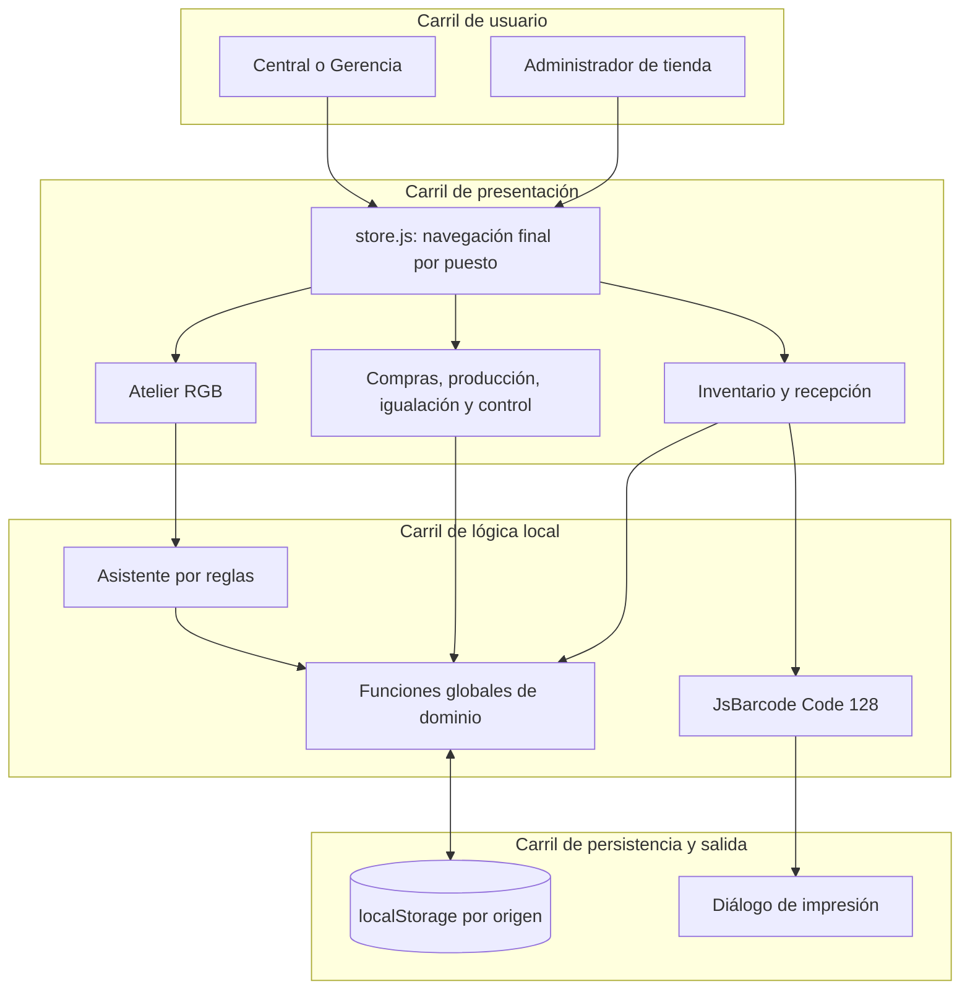
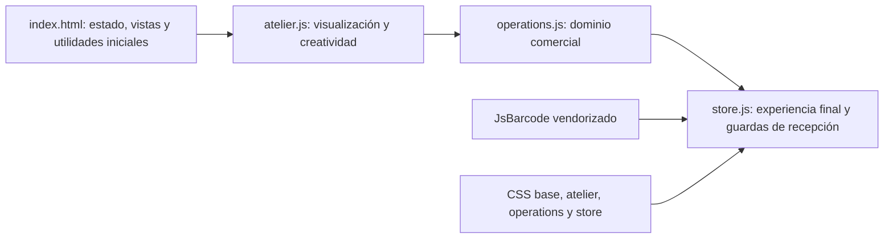
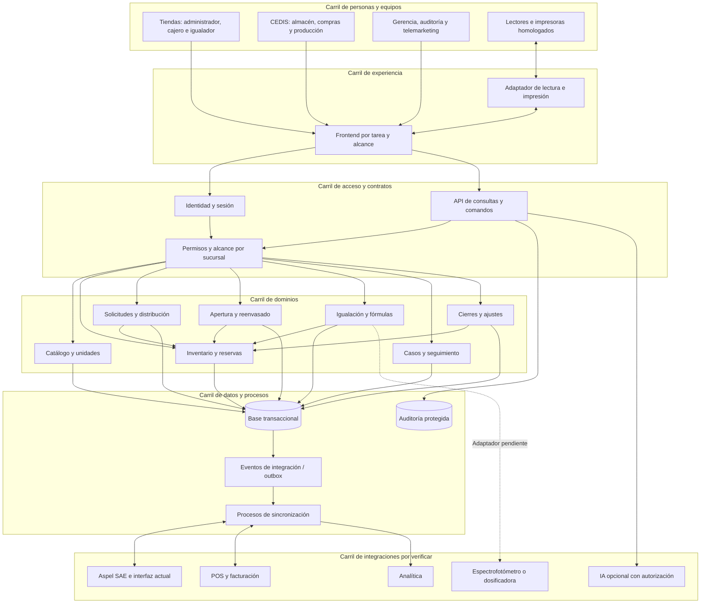
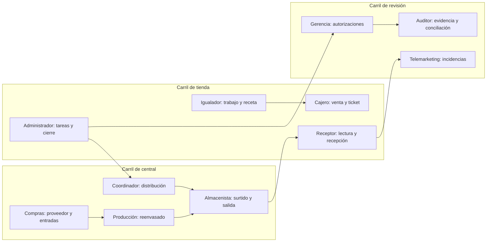
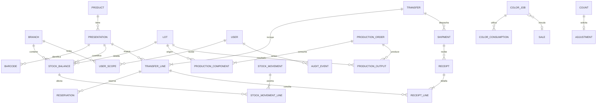
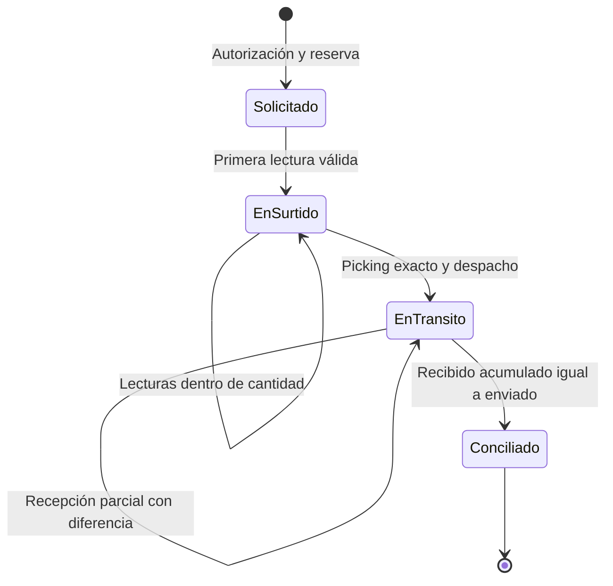
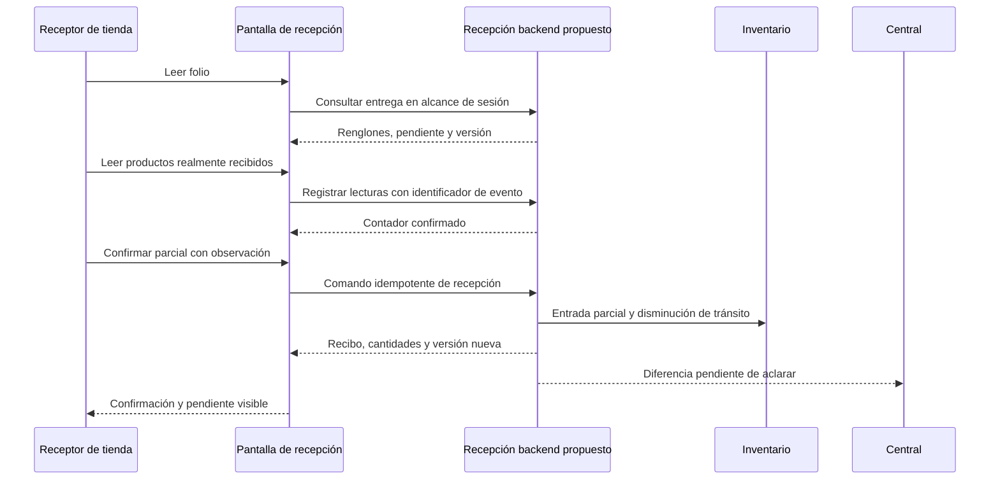
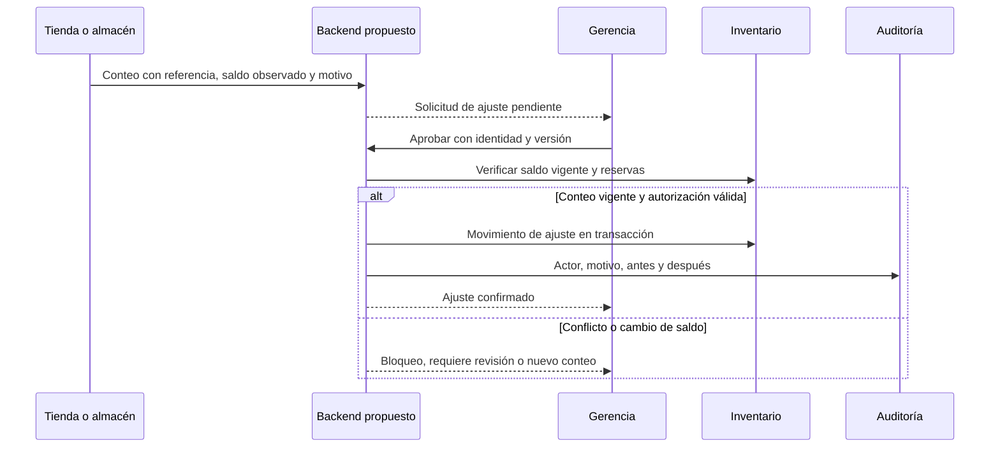
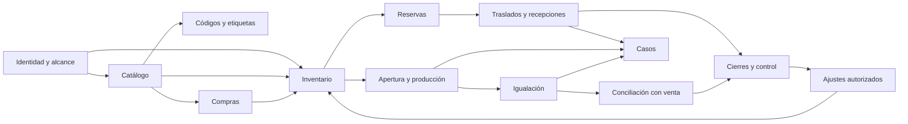

# Arquitectura, dependencias y carriles

[Volver al manual](../README.md)

Este documento distingue **lo que ejecuta el prototipo** de una **propuesta para el sistema definitivo**. Los componentes backend y las entidades propuestas todavía no existen en este repositorio.

## 1. Arquitectura actual

La aplicación es estática y ejecuta toda la lógica dentro de una sesión de navegador. Cualquier proveedor HTTP de archivos estáticos puede servir `dist/`.

### Orden y dependencia de las capas

- Los scripts clásicos comparten ámbito global. Cargar un archivo aislado no reproduce la aplicación completa.
- `operations.js` crea el catálogo comercial y `ops`; `store.js` agrega las solicitudes de tienda y redefine la recepción para exigir lectura.
- El modelo inicial `state` y el modelo comercial `ops` coexisten. No hay un único catálogo consolidado entre el atelier y el inventario comercial.
- Las etiquetas se generan como SVG. La entrada por lector se representa como texto seguido de Enter; la demo no verifica un dispositivo físico.
- Las reglas y la bitácora locales son modificables desde el navegador. No hay integridad de servidor.
- La navegación final elimina las vistas de guion y levantamiento. Las definiciones heredadas no son módulos productivos vigentes.

## 2. Arquitectura propuesta por carriles

**Propuesta inicial para evaluar:** un backend con dominios separados y una base transaccional. El despliegue y el proveedor de infraestructura deberán decidirse después de conocer SAE, conectividad, operación y requerimientos de recuperación.

Las líneas hacia SAE, POS, IA y equipos representan necesidades de integración, no capacidades confirmadas. La autorización debe aplicarse antes de ejecutar reglas o consultar datos, incluidas las consultas del asistente.

## 3. Usuarios y límites de acceso

### Carriles de responsabilidad

### Matriz propuesta de permisos

Leyenda: **P** = proponer/capturar; **E** = ejecutar; **A** = aprobar; **L** = leer dentro del alcance autorizado; **—** = no previsto por defecto. Esta matriz requiere aprobación del negocio.

| Acción | Admin tienda | Almacén | Coordinación | Compras | Producción | Igualador | Gerencia | Telemarketing |
|---|---|---|---|---|---|---|---|---|
| Existencias | L propia | L CEDIS | L red | L red | L insumos | L propia | L red | L acotada |
| Solicitar producto | P propia | — | P/E | — | P insumos | P propia | L | P caso |
| Autorizar distribución | — | — | A | — | — | — | A | — |
| Picking | — | E origen | L | — | — | — | L | — |
| Despachar | — | E autorizado | A/E | — | — | — | L | — |
| Recibir traslado | E propia | E CEDIS | L | — | — | — | L | L incidencia |
| Recibir proveedor | — | E físico | L | A/E documental | — | — | L | — |
| Ejecutar reenvasado | — | — | L | L | E | — | A excepciones | — |
| Fórmula/igualación | L propia | — | L | — | L | P/E propia | A política | L caso |
| Conteo | P propia | P CEDIS | L | — | P insumos | P asignado | L | — |
| Aprobar ajuste | — | — | — | — | — | — | A | — |
| Cierre | P propia | P ámbito | L | — | P producción | P trabajo | A revisión | — |
| Resolver caso | P evidencia | P evidencia | E logística | E proveedor | E producción | E técnica | A excepción | E seguimiento |

**Identidad propuesta:** usuario autenticado + puestos asignados + conjunto de sucursales autorizadas + permisos de acción. `branchId` enviado por el frontend nunca amplía ese conjunto. La autorización se valida tanto en consultas como en comandos y archivos descargables.

La separación de quien captura y quien aprueba debe definirse por persona real. En la demo es posible cambiar un selector y realizar ambas tareas; eso no cumple segregación de funciones.

## 4. Modelo de información propuesto

### Límites de las entidades

| Concepto | Identifica | No debe confundirse con |
|---|---|---|
| Producto | Identidad comercial/técnica | Cada presentación o cada lote |
| Presentación | Cantidad y unidad comercial, factor autorizado | Código genérico que agrupa colores diferentes |
| Código de barras | Alias resoluble de una entidad y tipo | Garantía de origen, número de serie o evidencia de recepción |
| Lote | Procedencia/producción y atributos trazables | Saldo total de un SKU |
| Reserva | Compromiso de disponibilidad | Descuento físico ya despachado |
| Movimiento | Hecho confirmado de entrada/salida/transformación | Edición directa de un contador |
| Tránsito | Cantidad despachada pendiente de destino o resolución | Merma ya reconocida |
| Trabajo de color | Producción e información técnica | Venta cobrada o factura emitida |
| Caso | Seguimiento de una necesidad o incidencia | Autorización para cambiar inventario |

El esquema definitivo de ubicaciones, almacenes virtuales, lotes y contabilidad de movimientos depende de la fuente de verdad acordada con SAE.

## 5. Estados y carriles críticos

### Traslado

Este es el flujo demostrado. Cancelación, rechazo, liberación de reserva, daño, devolución y pérdida requieren estados o documentos compensatorios aprobados. No deben implementarse borrando el traslado.

### Recepción parcial por carriles

### Ajuste por conteo

## 6. Dependencias entre dominios

La implementación puede agrupar dominios en un mismo servicio inicial, conservando sus contratos y transacciones. La división en procesos o despliegues independientes debe justificarse por requisitos medidos.

## 7. Integridad operativa que debe diseñarse

- **Reserva concurrente:** dos tiendas no pueden comprometer la misma disponibilidad más allá del saldo permitido.
- **Transacción de despacho:** estado, movimiento y auditoría se confirman juntos.
- **Recepción idempotente:** repetir la confirmación tras perder conexión devuelve el mismo resultado.
- **Lecturas distintas:** una lectura real adicional tiene un evento nuevo; un reenvío de la misma lectura conserva el mismo identificador.
- **Auditoría:** la aplicación no permite editar o eliminar eventos para hacer coincidir saldos.
- **SAE:** los comandos locales y los externos se correlacionan para detectar duplicados, fallas y retrasos.
- **Fecha operativa:** distinguir hora de evento, zona horaria y fecha de cierre de negocio.
- **Precisión:** definir cantidades decimales y tolerancias por unidad; no usar flotantes de JavaScript como política de saldo productivo.
- **Recuperación:** definir respaldo, restauración, colas pendientes y conciliación posterior a fallos.

Estas condiciones se formalizan en [contratos](contratos-api.md) y [decisiones](decisiones-backend.md).
