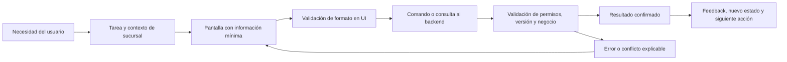

# Frontend · historias de usuario y continuidad UX

[Volver al manual](../README.md)

Esta es la sección de trabajo del frontend. No es una pantalla del cliente. El objetivo es conservar una experiencia sencilla por tarea al conectar el prototipo con servicios reales.

**Leyenda de estado:**

- **Demo:** interacción implementada localmente, con datos ficticios.
- **Backend:** comportamiento que deberá implementarse en servidor.
- **Por validar:** política de negocio o integración sin aprobación todavía.

## 1. Navegación y alcance

| Contexto | Navegación principal | Accesos secundarios | Regla para producción |
|---|---|---|---|
| Administrador de tienda | Mi tienda, Mi inventario, Recibir pedidos, Solicitar producto, Igualaciones | Etiquetas desde inventario; cierre desde inicio | La sucursal proviene de la sesión y sólo cambia dentro de alcances autorizados |
| Central / CEDIS | Control central, Inventario de la red, Surtido y traslados, Códigos y etiquetas, Compras, Producción, Igualaciones, Atelier de color, Telemarketing, Control y cierres | Fichas, historial, impresión y recomendaciones | Mostrar acciones según puesto real, además del alcance de red |
| Gerencia | Navegación central de la demo | Aprobar ajustes | Separar supervisión de ejecución y capturar autorización real |

El selector actual explora perfiles de demostración. Debe sustituirse por sesión y permisos. El menú de tienda mantiene cinco opciones; las herramientas de planificación del proyecto no deben regresar a ese menú.

## 2. Conexión entre intención, pantalla y servicio



La validación de UI orienta; el backend decide. El frontend no calcula un saldo definitivo a partir de una intención pendiente ni cambia de estado sólo porque se pulsó un botón.

## 3. Historias acotadas

### UI-01 · Inicio de mi tienda

**Como** administrador de tienda, **quiero** ver mis pendientes y acciones principales, **para** operar sin revisar módulos de toda la red.

- **Interacción:** inicio con pedidos por recibir, solicitudes, diferencias e igualaciones de la sucursal.
- **Aceptación:** todos los indicadores corresponden al alcance; cada contador lleva a una lista consistente; sin pendientes se muestra un estado vacío útil.
- **Conexión:** sesión y resumen por sucursal; conservar hora de actualización.
- **Estado:** demo en `views.storehome`; autorización y datos compartidos requieren backend.

### UI-02 · Consultar existencia por código

**Como** administrador, **quiero** leer el código de un producto, **para** conocer la referencia y disponibilidad correcta de mi tienda.

- **Interacción:** foco en entrada → código + Enter → resultado con SKU, presentación, unidad, disponible y por recibir.
- **Aceptación:** código desconocido no altera datos; código válido no confunde presentaciones; una consulta repetida no mueve inventario; el dato indica su vigencia.
- **Conexión:** resolver alias de código y consultar existencias dentro del alcance.
- **Estado:** demo en `inventoryScanner`, `inventoryResult` y `bindStore`; lector físico por validar.

### UI-03 · Solicitar reposición

**Como** administrador, **quiero** solicitar referencia, cantidad y motivo, **para** que central revise mi necesidad.

- **Interacción:** formulario corto → envío → folio y estado por autorizar.
- **Aceptación:** cantidad positiva y coherente con unidad; productos descontinuados bloqueados; enviar no altera físico ni reserva todavía; reintentar no crea dos solicitudes.
- **Conexión:** crear solicitud y consultar su seguimiento.
- **Estado:** demo en `storeRequest`; idempotencia y seguimiento entre sesiones pendientes.

### UI-04 · Autorizar solicitud desde central

**Como** coordinador, **quiero** revisar una solicitud y la disponibilidad de origen, **para** instruir el traslado correcto.

- **Interacción:** solicitud → revisión → autorizar → folio de traslado vinculado.
- **Aceptación:** comprobar disponibilidad vigente; reservar una sola vez; reflejar relación solicitud/traslado; ante conflicto mostrar qué cambió y permitir revisar.
- **Conexión:** comando transaccional de autorización con versión observada.
- **Estado:** demo en `authorizeRequest`; surtido parcial, rechazo y cancelación por definir.

### UI-05 · Surtir leyendo referencias

**Como** almacenista, **quiero** leer cada producto contra la orden, **para** evitar sustituciones de SKU.

- **Interacción:** orden visible → código → contador validado → foco vuelve al campo.
- **Aceptación:** rechazar código ajeno; `PZA` suma una pieza por lectura; unidades continuas requieren cantidad declarada; no superar lo solicitado; no habilitar despacho incompleto.
- **Conexión:** sesión de picking con eventos de lectura identificados.
- **Estado:** demo en `shipmentReader` y `scanTransfer`; eventos de servidor y pruebas con lector pendientes.

### UI-06 · Despachar una orden

**Como** responsable de almacén, **quiero** confirmar una salida con responsable y etiqueta, **para** dejar evidencia de lo que se entregó a logística.

- **Interacción:** resumen del surtido → responsable → confirmar → tránsito y etiqueta de folio.
- **Aceptación:** cantidad exacta; comando único; descuento físico del origen y actualización de reserva juntos; un timeout no habilita un segundo despacho ciego.
- **Conexión:** comando de despacho con idempotencia y versión.
- **Estado:** demo en `dispatchTransfer`; confirmación duradera requiere backend.

### UI-07 · Recibir por folio y producto

**Como** receptor, **quiero** abrir una entrega y leer sus productos, **para** registrar lo que llegó a mi tienda.

- **Interacción:** lectura del folio → orden → lectura de referencias → responsable → confirmar.
- **Aceptación:** no abrir entrega fuera del alcance; no recibir antes de despacho; el folio no incrementa productos; confirmación bloqueada sin lecturas; no exceder pendiente.
- **Conexión:** consultar entrega, registrar lecturas y confirmar recibo.
- **Estado:** demo en `scanReceipt` y envoltura de `receiveTransfer` en `store.js`.

### UI-08 · Confirmar parcial y atender diferencia

**Como** receptor, **quiero** declarar una recepción incompleta con observación, **para** sumar sólo lo recibido y dejar seguimiento del faltante.

- **Interacción:** dos piezas leídas de tres → motivo → confirmar parcial → saldo pendiente visible.
- **Aceptación:** suma dos al destino y deja una pendiente; no compensa con otro SKU; una recepción posterior sólo puede afectar el resto; no se pierde la incidencia al recargar.
- **Conexión:** recepción parcial transaccional; resolución autorizada de diferencias en un flujo separado.
- **Estado:** parcial implementado en demo; daños, pérdida, devolución y resolución definitiva por definir.

### UI-09 · Identificar e imprimir

**Como** operador, **quiero** ver e imprimir etiquetas de producto y traslado, **para** apoyar consulta, surtido y recepción.

- **Interacción:** ficha/folio → vista previa → diálogo de impresión → retorno a la misma tarea.
- **Aceptación:** producto y traslado codifican entidades distintas; texto humano acompaña al código; impresión conserva márgenes; la UI no afirma “impreso” sólo por abrir el diálogo.
- **Conexión:** identificadores canónicos y plantilla homologada; impresión local o servicio según equipo elegido.
- **Estado:** Code 128 e impresión de navegador implementados; hardware, códigos reales y serialización pendientes.

### UI-10 · Registrar trabajo de igualación

**Como** igualador o responsable de tienda, **quiero** documentar trabajo, sistema, referencia y litros, **para** medir producción y vincular la venta.

- **Interacción:** captura de trabajo → producción sin venta o venta capturada → ticket cuando corresponde.
- **Aceptación:** la tienda queda fijada; marca y referencia obligatorias; litros positivos; ticket requerido si se declara venta; producción y venta no se suman como lo mismo.
- **Conexión:** orden técnica, estado comercial y vínculo al POS; consumo de bases como comando aparte y con receta autorizada.
- **Estado:** bitácora demo implementada; receta, consumos y venta real pendientes.

### UI-11 · Abrir envases manteniendo identidad

**Como** operador autorizado, **quiero** abrir una presentación cerrada, **para** disponer de litros sin perder el color y el lote de origen.

- **Interacción:** referencia + cantidad + lote → factor visible → confirmación → registro abierto.
- **Aceptación:** sólo factores homologados; no abrir stock reservado; bajar envases y crear litros en la misma operación; conservar genealogía.
- **Conexión:** orden de transformación con factor/versiones aprobados.
- **Estado:** demo local implementada; consumo posterior, medición y reglas por puesto pendientes.

### UI-12 · Reenvasar con balance

**Como** producción, **quiero** declarar envases y merma, **para** explicar consumo y remanente de materia prima.

- **Interacción:** proceso aprobado → cantidades → vista previa de balance → confirmar.
- **Aceptación:** evitar mezcla de dimensiones; no consumir más de lo disponible; generar lote y unidades terminadas; reportar merma separada; no ejecutar dos veces por reintento.
- **Conexión:** orden de producción con componentes, salidas, tolerancias y versión de receta.
- **Estado:** dos pares fijos de ejemplo en demo; modelos reales y calidad pendientes.

### UI-13 · Comprar y recibir parciales

**Como** compras, **quiero** crear una orden y recibir parte de ella, **para** mantener visible el saldo pendiente del proveedor.

- **Interacción:** proveedor/referencia/cantidad → orden → lote/caducidad/cantidad recibida → pendiente.
- **Aceptación:** entrada sólo en CEDIS; no superar pendiente; una recepción posterior conserva su propia evidencia; descontinuado bloquea nueva compra.
- **Conexión:** orden con renglones y recibos independientes; alta de catálogo con permiso y duplicados controlados.
- **Estado:** demo de una referencia; múltiples lotes por recibo y conciliación documental requieren backend.

### UI-14 · Reportar conteo

**Como** administrador, **quiero** reportar una diferencia física, **para** pedir revisión sin editar el saldo.

- **Interacción:** referencia + conteo + motivo → solicitud de ajuste.
- **Aceptación:** conteo no negativo; unidad coherente; sucursal de la sesión; no modificar físico durante la captura; mostrar estado pendiente.
- **Conexión:** conteo con instante, versión observada y evidencia autorizada.
- **Estado:** demo local; revisión persistente y evidencias requieren backend.

### UI-15 · Aprobar ajuste

**Como** gerencia, **quiero** revisar el antes/después y el motivo, **para** autorizar una corrección trazable.

- **Interacción:** detalle → aprobación → movimiento y registro de actor.
- **Aceptación:** permiso y segregación de persona; versión de saldo vigente; reservas compatibles; doble aprobación no duplica ajuste; rechazo tiene motivo.
- **Conexión:** aprobación condicionada y transacción de movimiento/auditoría.
- **Estado:** rol demo y guardas básicas implementados; segregación, rechazo y autorización real pendientes.

### UI-16 · Cerrar el día

**Como** administrador, **quiero** enviar el cierre de mi fecha operativa, **para** que central revise sus diferencias.

- **Interacción:** fecha + resultado + observaciones → envío → cierre visible.
- **Aceptación:** un cierre activo por tienda/fecha según política; estado claro de enviado/revisado; reapertura autorizada conserva historial; no afirmar conciliación automática.
- **Conexión:** expediente de cierre y revisión central, con vínculos a inventario/venta/producción.
- **Estado:** declaración local implementada; revisión formal y reapertura pendientes.

### UI-17 · Seguir caso de atención

**Como** telemarketing, **quiero** vincular un caso al folio operativo, **para** resolver con evidencia y dar seguimiento.

- **Interacción:** canal + categoría + folio + descripción → caso → nota de resolución.
- **Aceptación:** datos mínimos y permitidos; vínculo verificable; historial; no mover inventario al resolver un caso.
- **Conexión:** casos, responsables, estados y referencias de evidencia. Comunicaciones externas sólo mediante canales autorizados.
- **Estado:** captura/resolución locales; SLA, mensajes y datos de clientes pendientes.

### UI-18 · Explorar color y colecciones

**Como** responsable técnico/comercial, **quiero** explorar acabados y direcciones de temporada, **para** presentar una intención antes de validar la muestra física.

- **Interacción:** familia/color → ángulo/luz/brillo → proporciones/peso → comparación; brief/temporada → colección guardada.
- **Aceptación:** identificar el render como artístico RGB; no derivar fórmula física de HEX; no presentar reglas como IA; muestra simulada no manda comandos a equipos.
- **Conexión:** biblioteca creativa separada de recetas físicas; integración IA/equipo sólo tras aprobación.
- **Estado:** experiencia y curaduría por reglas implementadas; colorimetría y LLM reales pendientes.

## 4. Estados que toda pantalla conectada debe contemplar

| Estado | Qué muestra la UI | Acción permitida |
|---|---|---|
| Inicial / vacío | Qué tarea puede iniciar y por qué no hay resultados | Consultar, capturar o volver |
| Cargando | Mensaje localizado; mantener contexto | Evitar confirmaciones duplicadas |
| Confirmado | Resultado, folio, saldo/versiones y siguiente tarea | Continuar desde estado del servidor |
| Validación de formato | Campo y motivo precisos | Corregir sin perder datos |
| Regla de negocio | Stock insuficiente, producto bloqueado o estado incompatible | Revisar o solicitar intervención |
| Sin permiso | Mensaje de alcance, sin revelar datos ajenos | Volver a tareas autorizadas |
| Conflicto de versión | Qué dato cambió y por qué no se confirmó | Recargar y revisar antes de confirmar |
| Sin conexión | Borrador local o estado no confirmado, según política | No afirmar que movió inventario |
| Timeout / resultado incierto | Comando en consulta; referencia de seguimiento | Consultar antes de repetir |
| Diferencia abierta | Cantidad y motivo pendientes | Recibir remanente o pedir resolución autorizada |

## 5. Lectura y foco: contrato UX

1. Diferenciar visualmente **folio de entrega** y **producto**; la simbología no sustituye esa distinción.
2. Mantener referencia, presentación y unidad junto al contador.
3. Después de una lectura válida, conservar foco para la siguiente lectura y emitir feedback inequívoco.
4. Después de un error, no incrementar nada; mostrar motivo en el mismo bloque.
5. Decidir feedback audible con usuarios y condiciones del almacén; no asumir que habrá audio disponible.
6. Un error de red no debe invitar a escanear la misma pieza otra vez sin saber si el evento llegó.
7. Permitir captura manual asistida si el código es ilegible, bajo la política de trazabilidad aprobada.
8. La corrección de una lectura debe conservar evidencia y permisos. La demo no implementa un flujo completo de anulación de lecturas.

## 6. Adaptación del frontend al backend

### Separación recomendada

```text
pantalla / formulario
    ↓ intención del usuario
caso de uso frontend
    ↓ comando con identificador persistente
cliente de API
    ↓ respuesta o conflicto
estado de vista confirmado
    ↓
render y siguiente acción
```

- Extraer las funciones globales a módulos de dominio y servicios antes de sustituir almacenamiento.
- Crear un adaptador de datos. La UI llama al adaptador; el modo demo puede seguir usando memoria/localStorage durante la transición.
- Obtener rol y alcance de sesión real; retirar el selector demostrativo de producción.
- Cambiar `saveOps()` y mutaciones de `ops` por comandos; los componentes reciben modelos de lectura del servidor.
- Hacer del resultado incierto un estado explícito de UI, no un toast de error genérico.
- Separar el catálogo visual del atelier de productos reales, fórmulas y consumos físicos.

### Ejemplo de conexión, todavía no implementado

```javascript
// commandId se crea una sola vez por intención confirmada y se conserva al reintentar.
async function confirmarRecepcion({ receiptSessionId, version, commandId }) {
  const response = await fetch(
    `/api/v1/receipt-sessions/${receiptSessionId}/confirm`,
    {
      method: 'POST',
      headers: {
        'Content-Type': 'application/json',
        'Idempotency-Key': commandId
      },
      body: JSON.stringify({ expectedVersion: version })
    }
  );
  const result = await response.json();
  if (!response.ok) throw result.error;
  return result.data; // renderizar cantidades confirmadas, no calcularlas localmente.
}
```

Autenticación, protección de sesión y manejo de timeout dependen de las decisiones de seguridad. [Contrato propuesto](contratos-api.md).

## 7. Validación conjunta de UX y backend

- Recorrer una tarea completa con cada puesto, no sólo pantallas aisladas.
- Confirmar etiquetas del negocio con usuarios de tienda y almacén.
- Verificar permisos con peticiones directas además de navegación.
- Probar Enter, foco, lectura rápida y códigos ilegibles en hardware real.
- Probar doble clic, timeout y pérdida de conexión antes/después de confirmar.
- Revisar accesibilidad de teclado, mensajes y contraste; considerar lector de pantalla y tamaño real de terminal.
- Revalidar móvil y escritorio cuando se extraigan las capas actuales.
- Aceptar el corte operativo sólo si UI y backend explican los mismos folios, estados y cantidades.
